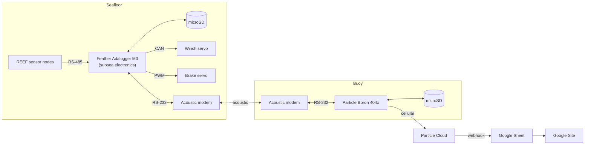

# IRIS: Integrated Reef Information System

Firmware for IRIS, a retractable cellular buoy that stays submerged and protected, then rises to the surface on a schedule to send underwater sensor data to shore. It was built as a Santa Clara University senior design project (2025-2026) as an add-on to the REEF sensor network from the SCU Robotics Systems Lab, which is planned for deployment at the Palos Verdes Reef.

The full design, analysis and test results are in the team's thesis:

**[IRIS - Integrated Reef Information System](https://scholarcommons.scu.edu/idp_senior)** (Friedel, Henderson, McCarthy, Pedroza, Steele-Maley, Santa Clara University, June 2026). This repository is the software side of that project. Section 4.2.8 and Appendix B of the thesis describe the software flow and source code.

## What it does

Before IRIS, getting data off a REEF sensor network meant sending a dive team to the reef, roughly once a year. IRIS listens to the sensor network, stores what it hears, and sends it to a web endpoint on a schedule with no divers involved. Between transmissions the buoy sits below the surface, which keeps it away from boats and weather and lowers the risk of marine life tangling in the tether.

1. The buoy's clock runs down to the next scheduled transmission.
2. The buoy tells the subsea electronics to deploy, using an acoustic modem.
3. The subsea electronics send all stored sensor readings to the buoy over acoustic, then release the brake and spool the buoy to the surface.
4. At the surface, the buoy connects to cellular and publishes the data to the cloud.
5. The buoy tells the subsea electronics to retract, and both sides go back to idle.

## Architecture



The two microcontrollers act as a pair of state machines:

- **Feather Adalogger M0** (`firmware/subsea-feather`) spends most of its time in a listen state, parsing REEF's RS-485 packets and logging them to CSV on its SD card. When it receives a deploy command it dumps the log, deploys, waits for a retract command, then retracts. States: `LISTEN`, `DUMP`, `DEPLOY`, `WAIT_RETRACT`, `RETRACT`.
- **Particle Boron 404x** (`firmware/buoy-boron`) keeps the deployment schedule, saves incoming data to its own SD card, publishes it to the Particle Cloud one row at a time, and sends the retract command once publishing is done.

### Messages between the two

Commands and data travel through the acoustic modems in short wrapped messages.

| Direction | Message | Meaning |
|---|---|---|
| Boron to Feather | `DEPLOY` | Start a transmission cycle |
| Boron to Feather | `RETRACT` | Bring the buoy back down |
| Feather to Boron | one CSV row per message | Stored sensor data |
| Feather to Boron | `DONE` | Data dump finished |
| Feather to Boron | `DEPLOYED` | Buoy is at the surface |
| Feather to Boron | `RETRACTED` | Buoy is back at rest |

Each row is `TIME,ADDRESS,TEMP,PH,COND,DO,CHECKSUM`. The Feather checks each REEF packet against its checksum before logging it, and discards packets that fail.

### Failsafes on the Boron

- If `DEPLOYED` does not arrive within 2 minutes, `DEPLOY` is re-sent up to 3 times. After that the Boron sends `RETRACT` and goes idle.
- If `RETRACTED` does not arrive within 30 seconds, `RETRACT` is re-sent up to 3 times. After that the retract is retried before the next deployment.
- If cellular does not connect within 10 minutes, the cycle is abandoned and the buoy is retracted.
- Each publish is retried up to 3 times, and progress through the data file is saved so a restart does not resend or skip rows.

## Repository layout

```
firmware/
  subsea-feather/       FinalFeather.cpp, final subsea electronics firmware
  buoy-boron/           FinalBoron.cpp, final buoy firmware
  variants/             FinalFeatherNoReef.cpp, bench version that reads a fixed
                        LOG_00.csv instead of listening for REEF data
development-history/
  component-tests/      single-purpose sketches for the servo and the SD card
  acoustic-link/        RS-485 and acoustic modem bring-up sketches
  winch-integration/    first versions that combined the data flow with winch control
  working-demo/         the working demo programs from before the final versions
```

The `development-history` folder is kept on purpose. Those files show how the system was brought up one piece at a time, and some are useful as minimal examples of a single part.

## Hardware

- Adafruit Feather M0 Adalogger (subsea electronics) and Particle Boron 404x (buoy)
- Succorfish Delphis acoustic modems, one on each side, with MAX3232 RS-232 converters
- RS-485 interface to the REEF network
- Blue Trail Engineering waterproof servo for the winch, controlled over CAN through an MCP2515, plus a PWM brake servo
- microSD storage on both boards

Mechanical design, wiring diagrams and the bill of materials are in the thesis (Chapter 3, Chapter 4 and Appendix A).

## Building and flashing

**Buoy (Boron):** Open `firmware/buoy-boron` in Visual Studio Code with the Particle Workbench extension. Libraries: `SdFat`. The Boron also needs a Particle account and device, and a webhook on the `sensor_data` event that forwards rows to a Google Sheet. The `cycle_start` and `cycle_end` events mark the beginning and end of each transmission.

**Subsea electronics (Feather):** Open `firmware/subsea-feather` in the Arduino IDE with the Adafruit Feather M0 Adalogger board selected. Libraries: `Adafruit MCP2515`, `SD`, `Servo`. The Arduino IDE expects a sketch to be a `.ino` file inside a folder of the same name, so rename the file when you open it there.

The deployment interval in `FinalBoron.cpp` (`DEPLOY_INTERVAL`) is set to 3 minutes so the cycle can be tested quickly. A real deployment would set it to the desired schedule, such as weekly.

## Testing and results

Testing ran in three stages: bench-top, tank and pool, and a bay deployment. The numbers below are from Chapter 5 of the thesis.

- **Winch repeatability:** 100 complete lower-and-raise cycles with a hanging weight, without the tether tangling.
- **Cellular payload:** The buoy floated in a test tank and sent more than 200 lines of sample sensor data, and lost one packet, which is 0.5%. The thesis suggests numbered lines and re-requests for missing data as the next step.
- **Bay deployment (Foster City):** 5 complete actuation cycles in the water, without data transfer.
- **End to end (SCU Malley Center pool):** The buoy autonomously sent the deploy command, received a data payload from the subsea electronics, surfaced, transmitted over cellular, and retracted, with no one intervening.

**Limits of what was tested:** In the pool test, the data sent was a payload already stored on the subsea electronics' SD card, because the REEF sensor network itself had wiring problems that were unrelated to IRIS. The REEF to cloud path was therefore not tested as one continuous chain. Open-ocean conditions (1.5 m waves, 15 m/s wind) were also not tested. The thesis lists these under future work.

## Credits

Built by Colin Friedel, Zach Henderson, Cooper McCarthy, Elias Pedroza and Thatcher Steele-Maley at Santa Clara University, with advisors Dr. Christopher Kitts and Dr. Michael Neumann. Colin Friedel wrote all of the firmware in this repository. The mechanical, buoy and winch design are covered in the thesis.

Thanks to the SCU Robotics Systems Lab and School of Engineering, MBARI, Blue Ocean Gear, and the other contributors acknowledged in the thesis.
